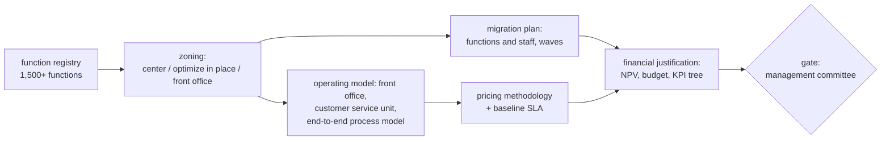

# Case: concept design of a shared services center — one design for 120 organizations

**English** | [Русский](../../ru/cases/01-concept-design/case.md)

> 120 organizations run settlement and customer-contact functions each on their own. The group
> wants one shared services center (SSC). Before anything is built, a single document must answer:
> what moves to the center, what the center is, what it costs — and what the management committee
> must decide. That document is the concept design. This case is about how it is built.

## Problem

Back-office functions (settlement and accrual calculation, billing and CRM operations, customer
contact) are duplicated across 120 organizations of the group: uneven quality, no economies of
scale, no common language for "which functions are ready to centralize". Building the center
means centralizing functions and the IT systems behind them, optimizing labor effort and headcount
on site, training people to work the new way — and defending all of it to the board before the
program spends its budget. Concept design is where everything has to fit together: done once, for
the full scope, in eight sections.

## Approach

The program office owns the methodology and templates, project teams design by them, the customer
approves — one design language across 120 organizations. The design covers the **full
organizational scope at once**, not just the pilot. Every section exists to remove a specific
risk of the "concept dies in detailed design" kind:

| # | Section | Covers |
|---|---|---|
| 1 | goals, scope | what the SSC takes over, and what it does not |
| 2 | process model design | centralization approach, target service registry, conceptual process maps, conceptual KPI system, optimization potential |
| 3 | service model design | service registry, interaction scheme, document flows, roles, top-level baseline SLA, pricing model, service scoring (SLA, NPS, CSI) |
| 4 | IT landscape architecture | system coverage of the functional map, network placement, target-landscape decision points |
| 5 | location options | geographic model, site-selection criteria |
| 6 | organizational structure | org model by block, target headcount, spans of control |
| 7 | financial justification | assumptions, function- and staff-migration plan, budget, KPI tree, IRR / NPV / payback / PI, sensitivity — the discipline of [case 3](../03-financial-case/case.md) |
| 8 | decisions required | what the management committee must decide to start detailed design |

Three design decisions carry the most weight.

**1. Zoning: every function gets exactly one decision.** The input is the function registry (see
[case 2](../02-business-architecture/case.md)); the output is a zoning map: *transfer to the SSC*
(with priority 1/2/3), *optimize in place*, *stay in the front office*, *competence center*.
Selection criteria: the operation is not tied to a location, is routine or digitizable, is not
corporate governance — and gains from scale when consolidated (centralization, automation,
unification, standardization).

**2. The operating model: who serves whom and how.** The front office stays with the companies;
a dedicated **customer service unit** on their side manages the relationship, quality and
escalations; the SSC runs the **single end-to-end process model** with measurable obligations —
SLA on the center's side, OLA on the customer's side. The commercial layer is a pricing
methodology in three stages: historical costs → time & materials → transactional price
(Tariff × Volume × Complexity). Each stage requires statistics that the previous one earns.

**3. Migration as a design object.** Functions do not move alone — people move with them. The
concept fixes the function and staff migration plan wave by wave, the ranking of organizations
by the integral value of connection, and the target headcount of the center. The human side is
planned by [change management](../04-change-management/case.md), not improvised at cutover.

## Artifacts (selected)

| Stage | Artifact | Why it exists |
|---|---|---|
| diagnostics | AS-IS process & org models, optimization-potential report | the comparison base and the effect justification |
| concept design | zoning map of functions | one decision per function — the boundary of the center |
| concept design | target service registry | future SSC services with priorities and process owners |
| concept design | ranking of organizations by connection value | wave order argued by facts, not politics |
| concept design | target headcount + location analysis | the basis of the org model and the budget |
| concept design | financial justification + KPI tree | the investment decision — see [case 3](../03-financial-case/case.md) |
| detailed design | service catalog + pricing methodology | the commercial part of the service model: what is sold, how price is computed |
| rollout | rollout plan + wave status reports | wave ordering and progress transparency through 2029 |

## Illustrative fragment (fictional data)

Zoning map entries:

| Function | Location-bound | Routine / digitizable | Scale effect | Decision |
|---|---|---|---|---|
| customer accrual calculation | no | yes | high | transfer to SSC — priority 1, wave 1 |
| supplier invoice reconciliation | no | yes | high | transfer to SSC — priority 1, wave 1 |
| field service dispatch | yes | partly | low | stays in the front office |
| process methodology development | no | no | — | competence center, not transferred |

## Result

The concept design passed the management committee and became the blueprint of the program: the
center is being built on the target service registry and the single end-to-end process model, the
rollout runs in waves through 2029, and the zoning map plus the baseline SLA became the group
standard for every later shared-services decision. The economics of the same design is a separate
discipline — [case 3](../03-financial-case/case.md); the people side of the same waves is
[case 4](../04-change-management/case.md).
