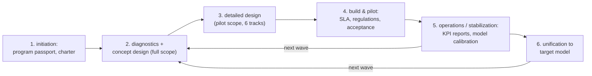

# Case: shared services center — from concept to group-wide rollout

**English** | [Русский](case.ru.md)

> A group of 100+ companies runs the same back-office functions separately: duplicated effort,
> uneven quality, no economies of scale, and no shared language for "which functions are ready to
> centralize". Building a shared services center (SSC) is a multi-year program — the question is
> what methodology keeps it alive from concept defense to full rollout.

## Problem

Back-office functions (settlement operations, customer contact) are performed independently in
every entity of the group. Consolidating them into a shared services center means: moving processes
across legal entities, building a new organization from scratch, designing a service model with
measurable obligations, justifying the economics to the board — and repeating the whole cycle for
each wave of connected companies. Without a stage-gated methodology, such programs stall after the
pilot.

## Approach

A **7-stage lifecycle, every stage closed by a management-committee gate** (readiness checklist +
protocol), with an iterative "pilot → rollout" principle: the rollout stage repeats the full
design-build-operate cycle for the next wave of functions and companies.

Two strategies exist, and the choice is fixed in the program passport:

- **centralize first, then unify** — move processes as-is, optimize afterwards (default choice:
  benefits start earlier, and the SSC learns real volumes before redesign);
- **unify first, then centralize** — optimize before transfer (requires justification: delays the
  effect and couples the redesign to every entity at once).

The **concept design is done once for the full organizational scope** (not just the pilot) — 8
sections, each with its purpose and the risks it removes:

| # | Section | Covers |
|---|---|---|
| 1 | goals, scope | what the SSC takes over, and what it does not |
| 2 | process model design | centralization approach, target service registry, conceptual process maps, conceptual KPI system, optimization potential |
| 3 | service model design | service registry, interaction scheme, document flows, roles, top-level baseline SLA, pricing model, service scoring (SLA, NPS, CSI) |
| 4 | IT landscape architecture | system coverage of the functional map, network placement, target-landscape decision points |
| 5 | location options | geographic model, site-selection criteria |
| 6 | organizational structure | org model by block, target headcount, spans of control |
| 7 | financial justification | assumptions, function-migration and staff-migration plan, budget, KPI tree, IRR / NPV / discounted payback / PI, sensitivity analysis |
| 8 | decisions required | what the management committee must decide to start detailed design |

## Artifacts (selected)

| Stage | Artifact | Why it exists |
|---|---|---|
| initiation | program passport | one document with volumes, pilot/rollout scope, budget, effects — the control baseline |
| diagnostics | AS-IS process & org models, optimization-potential report | the comparison base and the effect justification |
| concept design | target service registry | the catalog of future SSC services with priorities and process owners — the core of the service model |
| concept design | financial justification + KPI tree | the investment decision: NPV/IRR/DPP/PI, rollout plan tied to effects |
| detailed design | service catalog + pricing methodology | the commercial part of the service model: what is sold, how price is computed |
| detailed design | interaction regulation + document-flow schedule | the operational contract between the customer company and the SSC |
| build | SLA + regulations + operating instructions | measurable obligations and how they are executed |
| operations | KPI and service-level reports; labor/quality/salary matrices | facts against targets; the calibration base for the financial model before rollout |
| rollout | rollout plan + status reports | wave ordering and progress transparency |
| operations | SLA/OLA registry per service line | for every service: indicator, category, criticality, measurement method, target, period, data source |

## Illustrative fragment (fictional data)

A service-line SLA registry entry:

| Field | Value |
|---|---|
| Service | supplier invoice reconciliation |
| Indicator | share reconciled within SLA window |
| Formula | reconciled ≤ 3 days / total received |
| Target / threshold | 95% / 90% |
| Measurement window | month, business hours |
| Data source | ERP queue log |
| Exceptions | invoices pending client-side input |
| On breach | corrective-action plan, fee reduction per contract |

## Result

The center operates as a legal entity serving the group; the methodology survived its main test —
the **rollout plan runs in waves through 2029**, each wave repeating stages 2–5 from the target
registry, with KPI reports and a calibrated financial model as the gate between waves. The
service-model layer (SLA/OLA registries, pricing, interaction regulations) became the group
standard for every subsequent shared-services decision.

## What the folder shows

- the [SLA/OLA method](../../methodology/04-sla-ola.md) — how service-level indicators are made
  measurable and dispute-proof;
- the [financial justification method](../../methodology/05-фэм-и-обоснование-эффекта.md) — NPV/IRR
  done so the numbers survive board review;
- the [requirements checklist](../../checklists/02-требования-и-тз.md) — how specifications for
  the center's IT landscape were gated.
