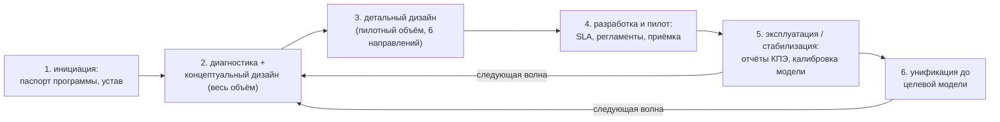

# Кейс: общий центр обслуживания — от концепции до тиража на всю группу

**[English](case.md) | Русский**

> Группа из 100+ компаний выполняет одни и те же бэк-офисные функции по отдельности: дублирование
> усилий, разное качество, никакого эффекта масштаба и общего языка «какие функции готовы
> к централизации». Создание общего центра обслуживания (ОЦО) — многолетняя программа; вопрос в том,
> какая методология удержит её живой от защиты концепции до полного тиража.

## Проблема

Бэк-офисные функции (расчётные операции, клиентский контакт) каждая организация группы выполняет
сама по себе. Объединение их в общий центр обслуживания означает: перенос процессов между юрлицами,
построение новой организации с нуля, проектирование сервисной модели с измеримыми обязательствами,
обоснование экономики перед правлением — и повторение всего цикла для каждой волны подключаемых
компаний. Без этапно-гейтовой методологии такие программы останавливаются после пилота.

## Подход

**Жизненный цикл из 7 этапов, каждый закрыт гейтом управляющего комитета** (чек-лист готовности +
протокол), с итеративным принципом «пилот → тираж»: этап тиража повторяет полный цикл
«проектирование → внедрение → эксплуатация» для следующей волны функций и компаний.

Существуют две стратегии, и выбор фиксируется в паспорте программы:

- **сначала централизация, затем унификация** — перенос процессов «как есть», оптимизация после
  (выбор по умолчанию: эффекты начинаются раньше, центр учится на реальных объёмах до
  перепроектирования);
- **сначала унификация, затем централизация** — оптимизация до переноса (требует обоснования:
  откладывает эффект и связывает перепроектирование со всеми организациями сразу).

**Концептуальный дизайн выполняется один раз на весь организационный объём** (не только пилот) —
8 разделов, у каждого своё назначение и снимаемый риск:

| # | Раздел | Что покрывает |
|---|---|---|
| 1 | цели и объём | что центр забирает, а что — нет |
| 2 | дизайн процессной модели | подход к централизации, целевой реестр услуг, концептуальные карты процессов, концептуальная система КПЭ, потенциал оптимизации |
| 3 | дизайн сервисной модели | реестр услуг, схема взаимодействия, документооборот, роли, верхнеуровневый базовый SLA, ценовая модель, оценка сервисов (SLA, NPS, CSI) |
| 4 | архитектура ИТ-ландшафта | покрытие функциональной карты системами, сетевое размещение, технологические развилки целевого ландшафта |
| 5 | варианты размещения | географическая модель, критерии выбора локации |
| 6 | организационная структура | оргмодель по блокам, целевая численность, нормы управляемости |
| 7 | экономическое обоснование | предпосылки, план тиража функций и миграции персонала, бюджет, дерево КПЭ, IRR / NPV / дисконтированный срок окупаемости / PI, анализ чувствительности |
| 8 | решения, которые необходимо принять | что управляющий комитет должен решить для перехода к детальному дизайну |

## Артефакты (выборка)

| Этап | Артефакт | Зачем он |
|---|---|---|
| инициация | паспорт программы | один документ с объёмами, пилотом/тиражом, бюджетом и эффектами — база контроля |
| диагностика | процессная и оргмодели «как есть», отчёт о потенциале оптимизации | база сравнения и обоснование эффекта |
| концептуальный дизайн | целевой реестр сервисов и услуг | каталог будущих услуг центра с приоритетами и владельцами процессов — ядро сервисной модели |
| концептуальный дизайн | экономическое обоснование + дерево КПЭ | инвестиционное решение: NPV/IRR/DPP/PI, план тиража привязан к эффектам |
| детальный дизайн | каталог услуг + методика ценообразования | торговая часть сервисной модели: что продаётся и как считается цена |
| детальный дизайн | регламент взаимодействия + график документооборота | операционный контракт между компанией-заказчиком и центром |
| внедрение | SLA + регламенты + операционные инструкции | измеримые обязательства и порядок их исполнения |
| эксплуатация | отчёты по КПЭ и уровню сервиса; матрицы трудозатрат/качества/зарплат | факт против цели; база калибровки ФЭМ перед тиражом |
| тираж | программа тиража + отчёты о статусе | очерёдность волн и прозрачность прогресса |
| эксплуатация | реестр SLA/OLA по каждому направлению услуг | по каждой услуге: показатель, категория, критичность, метод измерения, целевое значение, периодичность, источник данных |

## Иллюстративный фрагмент (данные вымышленные)

Запись в реестре SLA по направлению услуг:

| Поле | Значение |
|---|---|
| Услуга | сверка счетов-фактур поставщиков |
| Показатель | доля сверенных в срок SLA |
| Формула | сверенные ≤ 3 дней / всего полученных |
| Целевое / пороговое | 95% / 90% |
| Окно измерения | месяц, рабочие часы |
| Источник данных | журнал очередей ERP |
| Исключения | счета в ожидании ввода со стороны клиента |
| При нарушении | план корректирующих мер, снижение оплаты по договору |

## Результат

Центр работает как юрлицо, обслуживающее группу; методология прошла главное испытание — **план
тиражирования идёт волнами до 2029 года**, каждая волна повторяет этапы 2–5 от целевого реестра,
а гейтом между волнами служат отчёты по КПЭ и калиброванная финансовая модель. Сервисный слой
(реестры SLA/OLA, ценообразование, регламенты взаимодействия) стал групповым стандартом для всех
последующих решений об общих центрах обслуживания.

## Что показывает папка

- [методика SLA/OLA](../../methodology/04-sla-ola.md) — как показатели уровня сервиса делаются
  измеримыми и спор-устойчивыми;
- [методика ФЭМ](../../methodology/05-фэм-и-обоснование-эффекта.md) — NPV/IRR так, чтобы цифры
  прошли проверку правления;
- [чек-лист требований](../../checklists/02-требования-и-тз.md) — как гейтовались спецификации
  ИТ-ландшафта центра.
