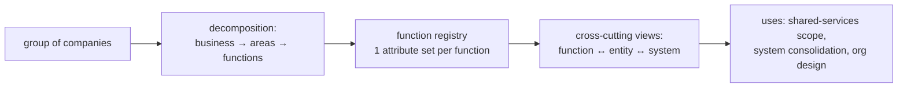

# Case: business architecture — the component model of a corporate group

**English** | [Русский](../../ru/cases/02-business-architecture/case.md)

> A nationwide business group, dozens of legal entities: everybody knows their own piece, nobody
> sees the whole. Decisions on centralization, systems and organizational change are argued by
> opinion, not by facts.

## Problem

In a multi-entity group the same questions come back every year: who actually performs which
function, where functions are duplicated, which entity should do what after reorganization, which
systems support which activities. Each subsidiary answers for itself; the group has no shared
language for "who does what". Every management decision on shared services, platform consolidation
or org change starts a new survey from zero.

## Approach

A **component model**: decompose the whole business into atomic, non-overlapping components
(business functions), and give every component a fixed set of attributes — performer, systems,
inputs/outputs, volume drivers, frequency.

Principles that made it work:

1. **Atomicity** — a function is either delegated entirely or not at all; "partially centralized"
   is a design smell.
2. **One register** — every function lives once; entities are *views*, not copies.
3. **Facts over claims** — volume and frequency attributes come from systems, not interviews;
   interview figures are marked as estimates.
4. **Decision-first** — every attribute exists because some decision needs it (centralize, buy,
   automate); attributes nobody uses are cut.

## Artifacts

- a function registry of **1,500+ business functions** with performer, systems, volume drivers;
- cross-cutting matrices: function ↔ legal entity, function ↔ IT system, function ↔ region;
- duplication and gap views: which functions several entities perform, which nobody owns;
- a baseline for shared-services scoping: candidate functions for centralization, ranked by volume
  and variability.

## Illustrative example (fictional data)

| Function | Entity A | Entity B | System | Volume | Centralization candidate |
|---|---|---|---|---|---|
| customer invoice reconciliation | performs | performs (duplicated) | ERP-A / ERP-B | 12k/month | yes — standardizable |
| field service dispatch | performs | — | field app | 900/month | no — regional specifics |
| marketing campaign design | — | performs (no owner in A) | manual | 4/month | review |

## Result

The group got a shared language for "who does what": business-architecture transparency, decisions
on centralization and platform consolidation argued by facts, and — the key compounding effect —
the registry became the standing baseline for the **shared-services program**: candidate services
were selected from the registry, not from a new survey each time.

The same registry feeds the rest of the portfolio: the zoning map of
[case 1 — concept design](../01-concept-design/case.md) starts from it, and the volume drivers of
[case 3 — the financial case](../03-financial-case/case.md) come from it.
