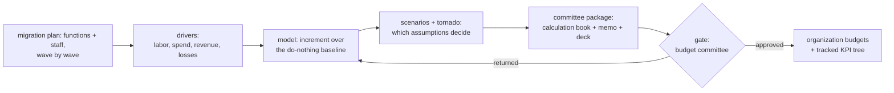

# Case: the financial case — moving 120 organizations to one shared service

**English** | [Русский](../../ru/cases/03-financial-case/case.md)

> A multi-year migration of 120 organizations to a single shared service lives or dies at the
> budget committee. The model is the easiest thing to attack: hidden assumptions, a single-point
> forecast, "labor savings" counted as cash. This case shows how the numbers are built to survive
> the attack — and how the same plan becomes the organizations' budgets.

## Problem

The economics of the program ties together everything designed in the concept (see
[case 1](../01-concept-design/case.md)): functions and people migrate in waves, every wave spends
and releases resources, and the effect is spread over years. Typical failures: the effect
computed as one confident number; released labor counted as savings; no baseline ("compared to
what?"); sensitivity shown as one extra scenario — or not at all; and migration plans too coarse
to become budgets, so every organization argues its own numbers.

## Approach

**The migration plan is the spine of the model.** Wave by wave, for each organization: which
functions move, which people move with them, what is spent (transfer, parallel run, training,
redeployment) and what is released (labor capacity, IT spend, premises). The same plan, priced,
becomes the transition budget of each organization — there are no two versions of the truth.

Around that spine, five rules keep the case defensible:

1. **Baseline first.** The effect is the difference of cash flows "with the program" and "without
   it". Without the do-nothing baseline, the case proves nothing about paying back at all.
2. **Drivers, not wishes.** Effects decompose into drivers: released labor hours × fully loaded
   rate, reduced spend, revenue growth, avoided losses. Released labor is labeled *capacity*,
   not cash, until a headcount decision exists — the most common way such cases get inflated.
3. **Every assumption carries a source** or is explicitly marked "assumption" and enters the
   range. Direct, indirect and hard-to-measure effects are kept apart; no effect is counted
   twice in the program perimeter.
4. **The result is a fork.** Pessimistic / base / optimistic scenarios plus a tornado analysis:
   which assumptions move NPV most — and which of them to verify first.
5. **The committee package is three artifacts, not one:** a calculation book (assumptions →
   drivers → formulas → scenarios, live formulas, nothing hardcoded), a decision memo (one
   recommendation, the conditions under which it changes, 1–2 risks with owners), and a deck
   where every slide maps to a calculation-book sheet.

## Artifacts

- a **financial model workbook**: assumptions with sources → drivers → NPV / ROI / payback per
  scenario → sensitivity sheet, on live formulas so the committee can test its own inputs;
- **detailed migration plans** of functions and staff per wave (120 organizations), each priced;
- **organization transition budgets** derived from the same plans — one source of numbers for the
  center, the finance function and the organizations;
- a **KPI tree** linking the program's top-level effect to every executor's indicator, so the
  promised effect stays traceable after approval;
- the **decision memo format** and the defense deck mapped sheet-by-sheet to the calculation book.

## Illustrative example (fictional data)

| Assumption | Value in base | Sensitivity: NPV range if ±20% | Verify first because |
|---|---|---|---|
| released labor hours (wave 1) | 150k h/yr | large swing | needs a headcount decision to become cash |
| fully loaded rate | 1,900/h | medium | HR data, easy to verify |
| migration one-time cost | +25% overrun | large swing | vendor quotes exist only for wave 1 |
| discount rate | 14% | small | treasury input |

The tornado says where to spend review effort: converting released capacity into money and the
migration cost — not the discount rate everyone argues about.

## Result

The program's investment case passed the budget committee with the model intact — the discussion
shifted from "is this number real" to "which assumption do we verify first". Organization budgets
were formed from the migration plans, so the center, the finance function and the organizations
worked from the same numbers. The same discipline now gates AI-assisted modeling: the machine
drafts, the assumption sheet decides what is defensible.
