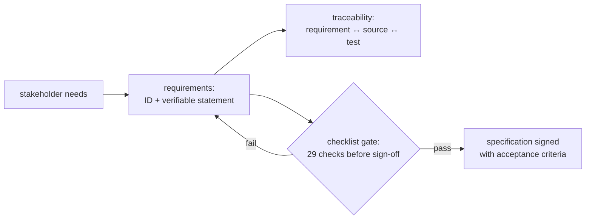

# Case: requirements engineering — specifications that survive procurement and acceptance

**English** | [Русский](case.ru.md)

> A specification signed by everyone, understood by no one: vague adjectives, conflicting clauses,
> acceptance criteria nobody can verify. The disputes surface at acceptance — when fixing costs
> the most.

## Problem

Government-style and enterprise procurement requires formal specifications (GOST 34 in the Russian
context), but a formal template does not make a specification workable. Typical defects: requirements
phrased as adjectives ("convenient", "fast"), contradictions between sections, no identifiers — so
no traceability, "TBD" without deadlines, acceptance criteria absent — so acceptance becomes a
negotiation.

## Approach

Requirements are written as verifiable statements with identifiers, and the document is checked
by a checklist before it is signed — not after disputes start.

| Layer | Rule set |
|---|---|
| Requirement | unique ID; unambiguous, verifiable, atomic, feasible, traceable to a source (ISO/IEC/IEEE 29148) |
| Specification (ТЗ) | all 10 sections of GOST 34.602-2020, in the standard's order; an empty section is kept with a note, not dropped |
| Software requirements (ФТ/SRS) | overview of functions, external interfaces, data, staging, verification |
| Language | no "and/or", "if possible", "best", "all", "always"; no negations ("must not") or passive voice; full references with date and version |

## Artifacts

- a requirements checklist (9 gates: uniqueness, verifiability, traceability, priority and acceptance
  criteria, GOST 34.602 structure, no TBD without deadline, no vague wording, no negations/passive,
  SRS coverage in the ФТ);
- the specification template following GOST 34.602-2020 section structure;
- a traceability pattern: requirement ↔ source ↔ acceptance test.

## Illustrative example (fictional data)

| Bad requirement | Why it fails | Fixed requirement |
|---|---|---|
| The system must be convenient for operators | unverifiable adjective | 95% of standard operator actions are completed in ≤ 3 clicks (measured from the action log, target 95%) |
| The system should support integrations "where possible" | no scope, no criteria | the system exchanges customer data with systems X and Y via REST API per the interface spec v2.1 |
| Response time is fast | no unit, no window | 95% of search requests return in ≤ 2 s during business hours (9:00–18:00) |

## Result

Specifications went through procurement and acceptance without requirement-level disputes: each
requirement carries an ID, a source and an acceptance criterion, so the discussion moves from
"what did the vendor mean" to "which criterion failed". The same checklist now gates AI-generated
drafts — the machine writes, the gate decides what is signable.

## What the folder shows

- the requirements checklist used as a sign-off gate (see [checklists](../../checklists/02-требования-и-тз.md));
- the GOST 34.602-2020 / ISO 29148 mapping table;
- a traceability pattern that keeps acceptance criteria attached to requirements.
