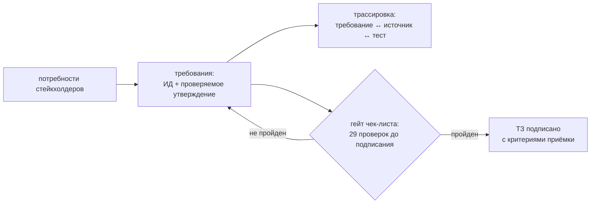

# Кейс: инженерия требований — спецификации, которые проходят закупку и приёмку

**[English](case.md) | Русский**

> ТЗ, подписанное всеми и не понятое никем: размытые прилагательные, противоречащие разделы,
> критерии приёмки, которые нельзя проверить. Споры всплывают на приёмке — когда исправлять дороже всего.

## Проблема

Формальные ТЗ обязательны для закупок (ГОСТ 34 в российской практике), но формальный шаблон не делает
спецификацию работоспособной. Типовые дефекты: требования в форме прилагательных («удобный»,
«быстрый»), противоречия между разделами, отсутствие идентификаторов — значит, нет трассировки,
«TBD» без сроков, критерии приёмки отсутствуют — приёмка превращается в переговоры.

## Подход

Требования пишутся как проверяемые утверждения с идентификаторами, а документ проверяется
чек-листом до подписания — а не после начала споров.

| Слой | Набор правил |
|---|---|
| Требование | уникальный ИД; однозначность, проверяемость, атомарность, выполнимость, трассируемость к источнику (ISO/IEC/IEEE 29148) |
| Спецификация (ТЗ) | все 10 разделов ГОСТ 34.602-2020 в порядке стандарта; пустой раздел сохраняется с записью, а не удаляется |
| Требования к ПО (ФТ/SRS) | обзор функций, внешние интерфейсы, данные, распределение по этапам, порядок проверки |
| Язык | нет «и/или», «по возможности», «лучший», «все», «всегда»; нет отрицаний («не должна») и пассива; полные ссылки с датой и версией |

## Артефакты

- чек-лист требований (9 гейтов: уникальность, проверяемость, трассируемость, приоритет и критерий
  приёмки, структура ГОСТ 34.602, нет TBD без срока, нет размытых формулировок, нет отрицаний
  и пассива, покрытие SRS в ФТ);
- шаблон ТЗ по структуре разделов ГОСТ 34.602-2020;
- паттерн трассировки: требование ↔ источник ↔ приёмочный тест.

## Иллюстративный пример (данные вымышленные)

| Плохое требование | Почему не работает | Исправленное |
|---|---|---|
| Система должна быть удобна операторам | непроверяемое прилагательное | 95% стандартных действий оператора выполняется за ≤ 3 клика (замер из журнала действий, целевое 95%) |
| Система должна поддерживать интеграции «по возможности» | нет периметра и критериев | система обменивается данными о клиентах с системами X и Y по REST API согласно спецификации интерфейсов v2.1 |
| Время отклика быстрое | нет единицы и окна измерения | 95% поисковых запросов возвращается за ≤ 2 с в рабочие часы (9:00–18:00) |

## Результат

Спецификации проходили закупку и приёмку без споров на уровне требований: у каждого требования есть
ИД, источник и критерий приёмки, поэтому обсуждение сдвигается с «что имел в виду поставщик» на
«какой критерий не выполнен». Тот же чек-лист теперь стоит гейтом для черновиков, написанных
ИИ-агентами: машина пишет — гейт решает, что можно подписывать.

## Что показывает папка

- чек-лист требований, работающий как гейт подписания (см. [checklists](../../checklists/02-требования-и-тз.md));
- таблицу соответствия ГОСТ 34.602-2020 / ISO 29148;
- паттерн трассировки, который держит критерии приёмки привязанными к требованиям.
