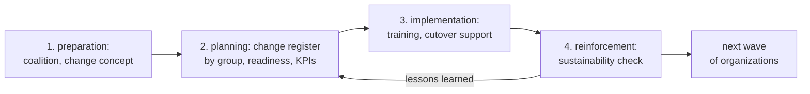

# Case: managing change on the ground — 120 organizations moving to new ways of working

**English** | [Русский](../../ru/cases/04-change-management/case.md)

> The design of a shared-services program (see [case 1](../01-concept-design/case.md)) is the
> easier half. The harder half happens on the ground: across 120 organizations, people change
> processes, tools, roles and reporting lines at the same time. The center gets its effect only
> when they work the new way — and that does not happen by announcement.

## Problem

When functions move to a shared center, the people around them do not just "get new software":
regional staff keep the front-office part of the process and hand the rest to the center; some
roles move to the center's locations; some are redesigned or reduced. Resistance is rational —
jobs and status change. Left unmanaged, the transition slips, quality drops during cutover,
duplicate operation persists — and the financial case (see
[case 3](../03-financial-case/case.md)) loses its headcount assumptions.

## Approach

Change management runs as **a mandatory methodology inside every project stage**, in four
phases — Preparation → Planning → Implementation → Reinforcement:

| Phase | What is done | What it produces |
|---|---|---|
| Preparation | a coalition of functional sponsors is built; the change concept is agreed: what changes, for whom, why now | change concept, sponsor coalition |
| Planning | changes are listed **by employee group** with impact and benefit scores; readiness is measured; support structure and KPIs are set | change register, readiness baseline, change KPIs |
| Implementation | role-based training on the live new processes ("work the new way", not a feature tour); support during cutover | trained groups, cutover support, adoption tracking |
| Reinforcement | sustainability is checked before the wave closes; lessons learned update the next wave's plan | sustainability scorecard, lessons log |

Principles that made it work:

1. **By group, not by newsletter.** "Dear colleagues" changes nobody. Every employee group sees
   its own list: what exactly changes in its work, what it gains, where to ask.
2. **Impact and benefit together.** A group that only loses something will fight; a group that
   sees its own benefit — growth, less routine, a real role — enrolls. Both are scored honestly.
3. **Training on live processes.** People are trained on the actual new process with the actual
   systems, in their role — not on generic slides.
4. **Measured like everything else.** Adoption KPIs (share of operations in the new process,
   readiness pulse, support ticket dynamics) are reviewed with the same discipline as SLA.

## Artifacts

- the change concept (what changes for whom and why) and the sponsor coalition map;
- the change register by employee group: what changes (process, role, tool, KPI), impact score,
  benefit for the group, support channel;
- a role-based training plan and materials for "work the new way";
- the change KPI set and readiness / sustainability scorecards;
- a cutover support structure: who answers what, in which channel, for how long;
- a lessons-learned log that updates the next wave's plan.

## Illustrative fragment (fictional data)

Change register entries:

| Employee group | What changes | Impact | Benefit | Support | Adoption KPI |
|---|---|---|---|---|---|
| settlement operators, regional office (12 people) | the back-office part of the process moves to the SSC; the front-office part stays | high | transfer to the center with a relocation package, or a redesigned local role | HR case manager, 2 weeks of training | share of operations handed over per plan |
| front-office agents (40 people) | new handover procedure and queues | medium | less routine rework, faster client answer | super-user on site | readiness pulse, ticket count |
| team leads (5 people) | team scope and role composition change | high | new team, methodology support from the program | sponsor one-on-ones | retention of key employees |

## Result

Waves closed with adoption KPIs green and support load falling from wave to wave — lessons
learned were fed back into plans instead of being re-learned. The transition period of each wave
ended by explicit completion criteria (SLA/OLA thresholds met, duplicate operations stopped,
headcount within plan), not by calendar. That is what turned the concept design and the financial
case from documents into a working service.
