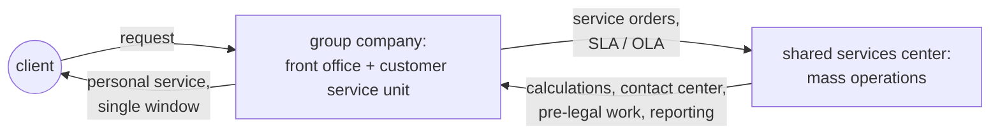

# Case: the end-to-end operating model — client → front office → shared services → customer service unit

**English** | [Русский](../../ru/cases/05-operating-model/case.md)

> A shared services center scoped as a standalone unit does not fix a broken client path: functions stay
> scattered across the group's legal entities, and every company answers only for its own piece. This case
> redesigns the client path as one whole — and it became the transformation standard for 120 organizations.

## Problem

The center was originally scoped as one more standalone division: collect the scattered functions,
standardize them, run them at scale. But the functions were fragmentarily distributed across the legal
entities of the group, so the client path was torn: one request crossed several companies, each running
its own local variation of the process. Responsibility boundaries were blurred — who answers to whom:
the front office to the client, the companies to the center, or the center to the companies. Interfaces
held on goodwill; nobody owned the client path end to end.

## Approach

An **end-to-end operating model**: the client path is designed as one whole across three roles. The
**front office** stays with the group companies — client centers and a single window: intake and
primary handling of client requests. The **customer service unit** on the company's side is the client
of internal services: it manages the relationship with the center under SLA, runs the service desk,
controls quality, coordinates the business units and owns the service budget. The **shared services
center** runs the mass operations — calculations, the contact center, pre-legal work, reporting.

Principles that made the model work:

1. **One path, designed whole.** The client path is modeled from request to result across all three
   roles; no role optimizes its own stretch at the neighbors' expense.
2. **The client sees one face.** Personal service stays with the group companies: front offices remain
   the face to the client; the center stays invisible to it.
3. **Somebody owns the internal client.** The customer service unit answers for the interaction with
   the center — SLA, quality, escalation, budget. "Who answers to whom" is fixed in the model, not
   implied by goodwill.
4. **Pay for the operation, not for headcount.** The service principle of the second wave: unify and
   automate first, move only the remainder into the center; the company pays for a completed
   operation, so the center grows with demand, not with budget.

## Artifacts

- an end-to-end process regulation with an explicit responsibility split — front office / customer
  service unit / shared services center — one document for **a group of 120 organizations**;
- role maps and a process-role matrix: who performs, who owns, who verifies each step of the client
  path;
- a service model: a service catalog, SLA/OLA and an interaction-and-escalation regulation between the
  companies and the center;
- a post-launch operating model: the interaction model and the document-flow schedule that keep the
  path working after go-live.

## Illustrative example (fictional data)

One client request of Entity A through the model:

| Client request | Front office | Customer service unit | Shared services center | Handover interface | SLA |
|---|---|---|---|---|---|
| accrual recalculation | accepts at the client center, classifies | opens a service ticket, routes by the catalog, monitors SLA | mass recalculation, outbound notification | service ticket + catalog item | 5 business days |
| billing dispute before court | accepts, owns the client communication | escalates per OLA, checks response quality | dispute review, pre-legal work | escalation regulation | 10 business days |
| new-connection application | single window: intake and primary check | completeness control, coordinates business units | — (stays in the front office) | not outsourced | same day |

## Result

The base design was defended and approved at the program's management committee, then turned into
target processes in alignment sessions. The model replaced fragmented, locally varied functions with
a single business architecture and a single client path: controllability — an end-to-end model instead
of localized functions — plus transparency and speed, while personal service stayed with the group
companies, whose front offices remain the face to the client.

The model became the transformation standard: a group of 120 organizations is rebuilding its client
path to fit it, and development continues in a second wave under the service principle above. The
model was born in the operating-model section of [case 1 — concept design](../01-concept-design/case.md),
stands on the function registry of [case 2 — business architecture](../02-business-architecture/case.md),
and its human side is [case 4 — change management](../04-change-management/case.md).
