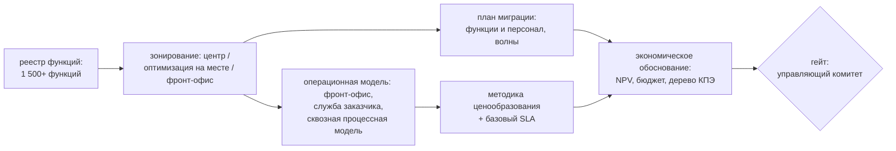

# Кейс: концептуальный дизайн общего центра обслуживания — один дизайн на 120 организаций

**[English](../../cases/01-concept-design/case.md) | Русский**

> 120 организаций выполняют расчётные и клиентские функции каждая по себе. Группа хочет один
> общий центр обслуживания (ОЦО). Прежде чем что-то строить, один документ должен ответить: что
> уходит в центр, каким будет центр, сколько это стоит — и что должен решить управляющий комитет.
> Этот документ — концептуальный дизайн. Кейс о том, как он строится.

## Проблема

Бэк-офисные функции (расчёты и начисления, операции биллинга и CRM, клиентский контакт)
дублируются в 120 организациях группы: разное качество, нет эффекта масштаба, нет общего языка
«какие функции готовы к централизации». Построить центр означает: централизовать функции
и ИТ-системы за ними, оптимизировать трудозатраты и численность на местах, обучить людей работе
по-новому — и защитить всё это перед правлением до того, как программа начнёт тратить бюджет.
Концептуальный дизайн — место, где всё сходится: один раз, на весь объём, в восьми разделах.

## Подход

Программный офис держит методику и шаблоны, проектные команды проектируют по ним, заказчик
согласует — один язык дизайна на 120 организаций. Дизайн выполняется **сразу на весь
организационный объём**, не только на пилот. У каждого раздела своя работа — снять конкретный
риск вида «концепция умрёт в детальном дизайне»:

| # | Раздел | Что покрывает |
|---|---|---|
| 1 | цели и объём | что центр забирает, а что — нет |
| 2 | дизайн процессной модели | подход к централизации, целевой реестр услуг, концептуальные карты процессов, концептуальная система КПЭ, потенциал оптимизации |
| 3 | дизайн сервисной модели | реестр услуг, схема взаимодействия, документооборот, роли, верхнеуровневый базовый SLA, ценовая модель, оценка сервисов (SLA, NPS, CSI) |
| 4 | архитектура ИТ-ландшафта | покрытие функциональной карты системами, сетевое размещение, развилки целевого ландшафта |
| 5 | варианты размещения | географическая модель, критерии выбора локации |
| 6 | организационная структура | оргмодель по блокам, целевая численность, нормы управляемости |
| 7 | экономическое обоснование | предпосылки, план миграции функций и персонала, бюджет, дерево КПЭ, IRR / NPV / окупаемость / PI, чувствительность — дисциплина [кейса 3](../03-financial-case/case.md) |
| 8 | решения, которые необходимо принять | что управляющий комитет должен решить для перехода к детальному дизайну |

Три проектных решения несут основной вес.

**1. Зонирование: каждой функции — ровно одно решение.** Вход — реестр функций (см.
[кейс 2](../02-business-architecture/case.md)); выход — карта зонирования: *передаётся в ОЦО*
(с приоритетом 1/2/3), *оптимизация на месте*, *остаётся во фронт-офисе*, *центр компетенций*.
Критерии отбора: операция не привязана к локации, рутинная или цифровизируемая, не относится
к корпоративному управлению — и даёт эффект масштаба при консолидации (централизация,
автоматизация, унификация, стандартизация).

**2. Операционная модель: кто кого обслуживает и как.** Фронт-офис остаётся в компаниях;
выделенная **служба заказчика** на их стороне управляет взаимоотношениями, качеством и
эскалациями; ОЦО исполняет **единую сквозную процессную модель** с измеримыми обязательствами:
SLA со стороны центра, OLA со стороны заказчика. Коммерческий слой — методика ценообразования
в три этапа: исторические затраты → время и материалы → транзакционная цена
(Тариф × Объём × Сложность). Каждый этап требует статистики, которую зарабатывает предыдущий.

**3. Миграция как объект дизайна.** Функции не переезжают одни — с ними переезжают люди. Концепт
фиксирует план миграции функций и персонала по волнам, ранжирование организаций по интегральной
ценности подключения и целевую численность центра. Человеческая сторона планируется
[управлением изменений](../04-change-management/case.md), а не импровизируется в момент
переключения.

## Артефакты (выборка)

| Этап | Артефакт | Зачем он |
|---|---|---|
| диагностика | процессная и оргмодели «как есть», отчёт о потенциале оптимизации | база сравнения и обоснование эффекта |
| концептуальный дизайн | карта зонирования функций | одно решение на функцию — граница центра |
| концептуальный дизайн | целевой реестр сервисов и услуг | будущие услуги центра с приоритетами и владельцами процессов |
| концептуальный дизайн | ранжирование организаций по ценности подключения | очерёдность волн на фактах, а не на политике |
| концептуальный дизайн | целевая численность + анализ локаций | основание оргмодели и бюджета |
| концептуальный дизайн | экономическое обоснование + дерево КПЭ | инвестиционное решение — см. [кейс 3](../03-financial-case/case.md) |
| детальный дизайн | каталог услуг + методика ценообразования | торговая часть сервисной модели: что продаётся и как считается цена |
| тираж | программа тиража + отчёты о статусе волн | очерёдность волн и прозрачность прогресса до 2029 года |

## Иллюстративный фрагмент (данные вымышленные)

Записи карты зонирования:

| Функция | Привязка к локации | Рутинная / цифровизируемая | Эффект масштаба | Решение |
|---|---|---|---|---|
| расчёт начислений клиентам | нет | да | высокий | передаётся в ОЦО — приоритет 1, волна 1 |
| сверка счетов-фактур поставщиков | нет | да | высокий | передаётся в ОЦО — приоритет 1, волна 1 |
| диспетчеризация выездных работ | да | частично | низкий | остаётся во фронт-офисе |
| разработка процессной методологии | нет | нет | — | центр компетенций, не передаётся |

## Результат

Концептуальный дизайн прошёл управляющий комитет и стал чертежом программы: центр строится
по целевому реестру услуг и единой сквозной процессной модели, тираж идёт волнами до 2029 года,
а карта зонирования и базовый SLA стали групповым стандартом для всех последующих решений об
общих центрах обслуживания. Экономика этого же дизайна — отдельная дисциплина,
[кейс 3](../03-financial-case/case.md); человеческая сторона тех же волн —
[кейс 4](../04-change-management/case.md).
