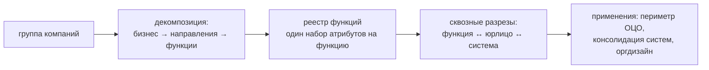

# Кейс: бизнес-архитектура — компонентная модель корпоративной группы

**[English](../../cases/02-business-architecture/case.md) | Русский**

> Группа компаний федерального масштаба, десятки юридических лиц: каждый знает свой кусок, никто не
> видит целое. Решения о централизации, системах и оргизменениях спорятся мнениями, а не фактами.

## Проблема

В многокомпонентной группе каждый год повторяются одни вопросы: кто реально выполняет какую функцию,
где функции дублируются, какое юрлицо должно делать что после реорганизации, какие системы какие
деятельности поддерживают. Каждая дочерняя компания отвечает за себя; у группы нет общего языка
«кто что делает». Любое управленческое решение — общие центры обслуживания, консолидация платформ,
оргизменения — начинается с нового обследования с нуля.

## Подход

**Компонентная модель**: декомпозировать весь бизнес на атомарные непересекающиеся компоненты
(бизнес-функции) и дать каждой фиксированный набор атрибутов — исполнитель, системы, входы/выходы,
драйверы объёма, периодичность.

Принципы, которые сделали модель работающей:

1. **Атомарность** — функция делегируется целиком или не делегируется; «частично централизована» —
   признак дефекта дизайна.
2. **Один реестр** — каждая функция живёт один раз; юрлица — это *разрезы*, а не копии.
3. **Факты против заявлений** — атрибуты объёма и периодичности собираются из учётных систем, документации и интервью;
   цифры интервью помечаются как оценки.
4. **От решения** — каждый атрибут существует потому, что под него есть решение (централизовать,
   купить, автоматизировать); атрибуты без решения-потребителя вырезаются.

Компонентная модель — один из инструментов бизнес-архитектуры программы, а не весь её состав. Тот же
набор: целевая процессная модель (целевые процессы 4-го уровня), зонирование функций (в ОЦО /
оптимизация на месте / фронт-офис), ролевая структура (реестр ролей, процессно-ролевая матрица),
сервисная модель (каталог + SLA/OLA), географическая модель размещения, дерево КПЭ и соглашения о
моделировании (BPMN 2.0).

## Артефакты

- реестр из **1 500+ бизнес-функций** с исполнителем, системами и драйверами объёма;
- сквозные матрицы: функция ↔ юрлицо, функция ↔ ИТ-система, функция ↔ регион;
- разрезы дублей и разрывов: какие функции выполняют несколько юрлиц, какие не принадлежат никому;
- база для периметра общих центров обслуживания: функции-кандидаты на централизацию, отранжированные
  по объёму и изменчивости.

## Иллюстративный пример (данные вымышленные)

| Функция | Юрлицо А | Юрлицо Б | Система | Объём | Кандидат на централизацию |
|---|---|---|---|---|---|
| сверка клиентских счетов-фактур | выполняет | выполняет (дубль) | ERP-A / ERP-B | 12 тыс./мес | да — стандартизируемая |
| диспетчеризация выездных работ | выполняет | — | мобильное приложение | 900/мес | нет — региональная специфика |
| дизайн маркетинговых кампаний | — | выполняет (в А нет владельца) | вручную | 4/мес | на пересмотр |

## Результат

Группа получила общий язык «кто что делает»: прозрачность бизнес-архитектуры, решения по
централизации и консолидации платформ — на фактах, и главное накапливаемое следствие — реестр стал
постоянной базой **программы общих центров обслуживания**: услуги-кандидаты выбирались из реестра,
а не из нового обследования каждый раз.

Тот же реестр питает и остальные кейсы портфеля: карта зонирования
[кейса 1 — концептуальный дизайн](../01-concept-design/case.md) начинается с него, а драйверы
объёма [кейса 3 — ФЭМ](../03-financial-case/case.md) берутся из него. См. также
[кейс 5 — сквозная операционная модель](../05-operating-model/case.md): клиентский путь, под который
группа теперь трансформируется.
