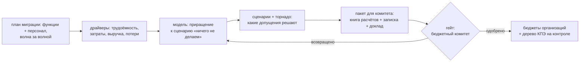

# Кейс: финансово-экономическая модель — перевод 120 организаций на единый сервис

**[English](../../cases/03-financial-case/case.md) | Русский**

> Многолетний перевод 120 организаций на единый сервис обслуживания живёт или умирает на
> бюджетном комитете. Финансовую модель атаковать проще всего: скрытые допущения, прогноз одной
> точкой, «экономия трудозатрат», посчитанная как деньги. Кейс показывает, как цифры строятся,
> чтобы атаку выдержать — и как тот же план становится бюджетами организаций.

## Проблема

Экономика программы связывает всё, что спроектировано в концепции (см.
[кейс 1](../01-concept-design/case.md)): функции и люди мигрируют волнами, каждая волна тратит
и высвобождает ресурсы, эффект размазан по годам. Типовые провалы: эффект посчитан одной
уверенной цифрой; высвобожденный труд засчитан как экономия; нет базового сценария («с чем
сравниваем?»); чувствительность показана одним запасным сценарием — или не показана вовсе;
а планы миграции слишком грубы, чтобы стать бюджетами, и каждая организация спорит своими
цифрами.

## Подход

**План миграции — хребет модели.** Волна за волной, по каждой организации: какие функции
переезжают, какие люди переезжают с ними, что тратится (перенос, параллельная работа, обучение,
перестройка ролей) и что высвобождается (трудоёмкость, ИТ-затраты, площади). Тот же план
в ценах становится переходным бюджетом каждой организации — двух версий правды нет.

Вокруг хребта — пять правил, которые держат кейс защищаемым:

1. **Сначала базовый сценарий.** Эффект — разница денежных потоков «с программой» и «без
   программы». Без сценария «ничего не делаем» кейс ничего не доказывает насчёт окупаемости.
2. **Драйверы, а не пожелания.** Эффект раскладывается на драйверы: высвобожденные часы ×
   полная ставка, сокращение затрат, рост выручки, снижение потерь. Высвобожденная трудоёмкость
   помечается как *мощность*, а не деньги — до решения о численности. Это самый частый способ
   такие кейсы раздуть.
3. **Каждое допущение — с источником** или явно помечено «допущение» и попадает в вилку. Прямые,
   косвенные и трудноизмеримые эффекты держатся раздельно; ни один эффект не считается дважды
   в периметре программы.
4. **Результат — вилка.** Пессимистичный / базовый / оптимистичный сценарии плюс анализ
   чувствительности (торнадо): какие допущения двигают NPV сильнее всего — и какие проверять
   первыми.
5. **Пакет для комитета — три артефакта, а не один:** книга расчётов (допущения → драйверы →
   формулы → сценарии, на живых формулах, ничего не вбивается числом), решающая записка (одна
   рекомендация, условия, при которых выбор меняется, 1–2 риска с владельцами) и доклад, где
   каждый слайд ссылается на лист книги расчётов.

## Артефакты

- **книга финансовой модели**: допущения с источниками → драйверы → NPV / ROI / окупаемость по
  сценариям → лист чувствительности, на живых формулах — комитет может подставить свои цифры;
- **детальные планы миграции** функций и персонала по волнам (120 организаций), каждый
  оценён в деньгах;
- **переходные бюджеты организаций**, собранные из тех же планов, — один источник цифр для
  центра, финансовой функции и организаций;
- **дерево КПЭ**, связывающее эффект верхнего уровня программы с показателями каждого
  исполнителя, — обещанный эффект трассируется после утверждения;
- **формат решающей записки** и доклад для защиты, привязанный лист-к-листу к книге расчётов.

## Иллюстративный пример (данные вымышленные)

| Допущение | Значение в базовом сценарии | Чувствительность: разброс NPV при ±20% | Почему проверять первым |
|---|---|---|---|
| высвобожденные трудочасы (волна 1) | 150 тыс. ч/год | большой разброс | чтобы стать деньгами, нужно решение о численности |
| полная ставка | 1 900/ч | средний | данные HR, проверить просто |
| разовые затраты миграции | +25% превышения | большой разброс | котировки поставщика есть только на волну 1 |
| ставка дисконтирования | 14% | маленький | вводные казначейства |

Торнадо показывает, куда тратить усилия проверки: конверсия высвобожденной мощности в деньги
и затраты миграции — а не ставка дисконтирования, о которой спорят все.

## Результат

Инвестиционное обоснование программы прошло бюджетный комитет с целой моделью — обсуждение
сдвинулось с «реальна ли эта цифра» на «какое допущение проверяем первым». Бюджеты организаций
сформированы из планов миграции: центр, финансовая функция и организации работают от одних цифр.
Та же дисциплина теперь гейтует моделирование с помощью ИИ: машина пишет черновик — лист
допущений решает, что защищаемо.
