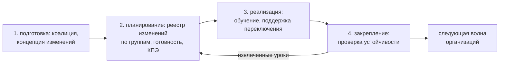

# Кейс: управление изменениями на местах — 120 организаций переходят на новые способы работы

**[English](../../cases/04-change-management/case.md) | Русский**

> Дизайн программы общего центра (см. [кейс 1](../01-concept-design/case.md)) — лёгкая половина.
> Тяжёлая половина происходит на местах: в 120 организациях люди одновременно меняют процессы,
> инструменты, роли и подчинение. Центр получит свой эффект, только когда они начнут работать
> по-новому — и это не происходит само собой, по объявлению.

## Проблема

Когда функции уходят в общий центр, люди вокруг них не просто «получают новую программу»:
региональные сотрудники оставляют себе фронт-офисную часть процесса и передают остальное в центр;
часть ролей переезжает в локации центра; часть перестраивается или сокращается. Сопротивление
рационально — меняются рабочие места и статус. Без управления переход затягивается, качество
падает в момент переключения, дублирующие операции живут дольше плана — и финансовая модель
(см. [кейс 3](../03-financial-case/case.md)) теряет свои предпосылки по численности.

## Подход

Управление изменениями идёт **обязательной методологией внутри каждого этапа проекта**, в четырёх
фазах — Подготовка → Планирование → Реализация → Закрепление:

| Фаза | Что делается | Что получается |
|---|---|---|
| Подготовка | строится коалиция функциональных заказчиков; согласуется концепция изменений: что меняется, для кого, почему сейчас | концепция изменений, коалиция заказчиков |
| Планирование | изменения собираются **по группам сотрудников** с оценкой влияния и выгод; измеряется готовность; определяются структура поддержки и КПЭ | реестр изменений, базовая готовность, КПЭ изменений |
| Реализация | ролевое обучение на живых новых процессах («работа по-новому», а не обзор функций); поддержка в момент переключения | обученные группы, поддержка переключения, трекинг внедрения |
| Закрепление | устойчивость проверяется до закрытия волны; извлеченные уроки обновляют план следующей волны | карта устойчивости, журнал уроков |

Принципы, которые сделали методику рабочей:

1. **По группам, а не письмом всем.** «Дорогие коллеги» не меняет никого. Каждая группа
   сотрудников видит свой список: что именно меняется в её работе, что она приобретает, куда
   обращаться.
2. **Влияние и выгода вместе.** Группа, у которой только отнимают, будет сопротивляться; группа,
   которая видит свою выгоду — рост, меньше рутины, настоящая роль, — подключается. И то и то
   оценивается честно.
3. **Обучение на живых процессах.** Люди учатся на реальном новом процессе с реальными
   системами, в своей роли — не на общих слайдах.
4. **Измеряется как всё остальное.** КПЭ внедрения (доля операций в новом процессе, пульс
   готовности, динамика обращений в поддержку) разбираются с той же дисциплиной, что и SLA.

## Артефакты

- концепция изменений (что меняется, для кого и почему) и карта коалиции заказчиков;
- реестр изменений по группам сотрудников: что меняется (процесс, роль, инструмент, КПЭ), оценка
  влияния, выгода группы, канал поддержки;
- ролевой план обучения и материалы для «работы по-новому»;
- набор КПЭ изменений и карты готовности / устойчивости;
- структура поддержки на переключении: кто отвечает на что, в каком канале, как долго;
- журнал извлеченных уроков, обновляющий план следующей волны.

## Иллюстративный фрагмент (данные вымышленные)

Записи реестра изменений:

| Группа сотрудников | Что меняется | Влияние | Выгода | Поддержка | КПЭ внедрения |
|---|---|---|---|---|---|
| операторы расчётов, региональный офис (12 человек) | бэк-офисная часть процесса уходит в ОЦО, фронт-офисная остаётся | высокое | перевод в центр с релокационным пакетом или перестроенная локальная роль | HR-менеджер кейса, 2 недели обучения | доля операций, переданных по плану |
| фронт-офисные агенты (40 человек) | новая процедура передачи и новые очереди | среднее | меньше переделок, быстрее ответ клиенту | супер-юзер на месте | пульс готовности, число обращений |
| руководители групп (5 человек) | меняются состав и охват команд | высокое | новая команда, методологическая поддержка программы | личные встречи со спонсором | удержание ключевых сотрудников |

## Результат

Волны закрывались с зелёными КПЭ внедрения и падающей от волны к волне нагрузкой на поддержку —
извлеченные уроки возвращались в планы, а не переучивались заново. Переходный период каждой
волны заканчивался по явным критериям готовности (пороги SLA/OLA выдержаны, дублирующие
операции прекращены, численность в пределах плана), а не по календарю. Именно это превратило
концептуальный дизайн и финансовую модель из документов в работающий сервис.
