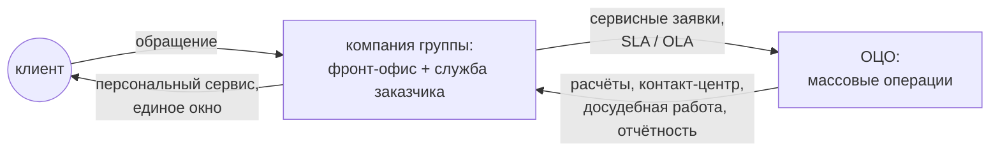

# Кейс: сквозная операционная модель — клиент → фронт-офис → ОЦО → служба заказчика

**[English](../../cases/05-operating-model/case.md) | Русский**

> ОЦО, спроектированный как обособленное подразделение, не чинит разорванный клиентский путь: функции
> остаются разбросанными по юрлицам группы, и каждая компания отвечает только за свой кусок. Здесь
> клиентский путь пересобран как единое целое — и стал стандартом трансформации для 120 организаций.

## Проблема

Центр изначально проектировался как ещё одно обособленное подразделение: собрать разбросанные функции,
стандартизировать, выполнять в масштабе. Но функции были фрагментарно распределены по юрлицам группы,
и клиентский путь оказывался разорванным: одно обращение пересекало несколько компаний, каждая со своей
локальной вариацией процесса. Границы ответственности были размыты — кто перед кем отвечает: фронт-офис
перед клиентом, компании перед центром или центр перед компаниями. Интерфейсы держались на доброй воле;
владельца сквозного клиентского пути не было.

## Подход

**Сквозная операционная модель**: клиентский путь проектируется как единое целое через три роли.
**Фронт-офис** остаётся за компаниями группы — клиентские центры и единое окно: приём и первичная
обработка обращений. **Служба заказчика** на стороне компании — «клиент внутренних сервисов»: управляет
взаимодействием с центром по SLA, ведёт service desk, контролирует качество, координирует подразделения
и держит бюджет на сервисы. **ОЦО** выполняет массовые операции — расчёты, контакт-центр, досудебную
работу, отчётность.

Принципы, которые сделали модель рабочей:

1. **Один путь, целиком.** Клиентский путь моделируется от обращения до результата через все три роли;
   ни одна роль не оптимизирует свой участок за счёт соседей.
2. **Клиент видит одно лицо.** Персональное обслуживание остаётся за компаниями группы: фронт-офисы —
   лицо к клиенту, центр для клиента невидим.
3. **У внутреннего клиента есть владелец.** За взаимодействие с центром отвечает служба заказчика —
   SLA, качество, эскалация, бюджет. «Кто перед кем отвечает» зафиксировано в модели, а не
   подразумевается доброй волей.
4. **Плата за операцию, а не за штат.** Сервисный принцип второй волны: сначала унификация и
   автоматизация, в центр уходит только остаток; компания платит за выполненную операцию — центр
   растёт от спроса, а не от бюджета.

## Артефакты

- регламент сквозного процесса с явным разграничением ответственности — фронт-офис / служба заказчика /
  ОЦО — один документ на **группу из 120 организаций**;
- карты ролей и процессно-ролевая матрица: кто выполняет, кто владеет, кто контролирует каждый шаг
  клиентского пути;
- сервисная модель: каталог услуг, SLA/OLA и регламент взаимодействия и эскалации между компаниями
  и центром;
- операционная модель после запуска: модель взаимодействия и график документооборота, которые держат
  путь рабочим после переключения.

## Иллюстративный пример (данные вымышленные)

Одно обращение клиента юрлица А через модель:

| Обращение клиента | Фронт-офис | Служба заказчика | ОЦО | Интерфейс передачи | SLA |
|---|---|---|---|---|---|
| пересчёт начислений | принимает в клиентском центре, классифицирует | открывает сервисную заявку, маршрутизирует по каталогу, следит за SLA | массовый пересчёт, исходящее уведомление | сервисная заявка + позиция каталога | 5 рабочих дней |
| спор по счетам до суда | принимает, держит коммуникацию с клиентом | эскалация по OLA, контроль качества ответа | разбор спора, досудебная работа | регламент эскалации | 10 рабочих дней |
| заявка на новое подключение | единое окно: приём и первичная обработка | контроль полноты, координация подразделений | — (остаётся во фронт-офисе) | не передаётся | в тот же день |

## Результат

Базовый дизайн защищён и утверждён на управляющем комитете программы, затем превращён в целевые
процессы на согласительных совещаниях. Модель заменила фрагментарные функции с локальными вариациями
единой бизнес-архитектурой и единым клиентским путём: управляемость — сквозная модель вместо
локализованных функций — плюс прозрачность и скорость, при сохранении персонального обслуживания:
фронт-офисы компаний группы остаются лицом к клиенту.

Модель стала стандартом трансформации: группа из 120 организаций перестраивает под неё клиентский путь,
развитие продолжается второй волной по сервисному принципу выше. Модель родилась в разделе «операционная
модель» [кейса 1 — концептуальный дизайн](../01-concept-design/case.md), стоит на реестре функций
[кейса 2 — бизнес-архитектура](../02-business-architecture/case.md), её человеческая сторона —
[кейс 4 — управление изменениями](../04-change-management/case.md).
